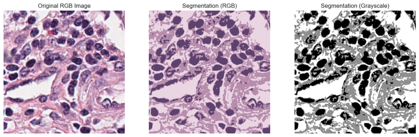
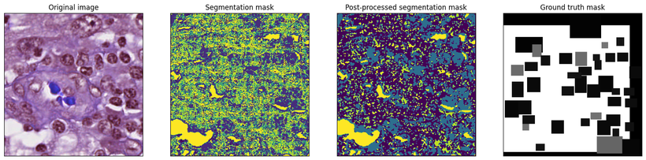
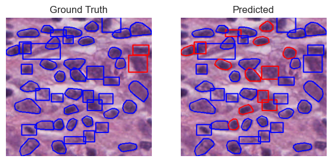
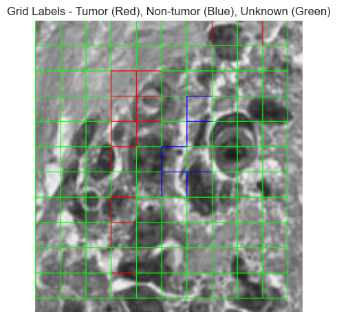
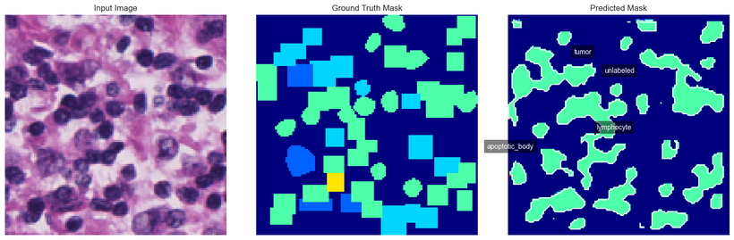
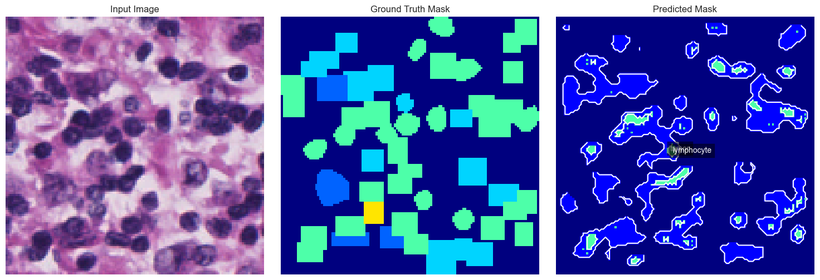

# Segmentation and Tumour Detection in Histopathology Images

Unsupervised and supervised segmentation of cell nuclei in H&E-stained breast-cancer
histopathology, followed by a blob-feature detection model that counts tumours per slide.

Built as a team project for **ECSE 415 (Computer Vision)** at McGill University, Winter 2025.

| | |
|---|---|
| **Data** | TCGA breast histopathology patches (H&E), with per-patch pixel coordinates and per-slide nuclei CSVs |
| **Unsupervised** | K-means clustering, with an elbow-method K search; compared against mean shift |
| **Supervised** | Random Forest over pixel features for segmentation |
| **Detection** | Masked regions of interest, background removal, blob + HOG features, Random Forest classifier |
| **Bonus** | Fine-tuning a pre-trained network to segment |

## Dataset

Patches are cut from TCGA whole-slide images and named by slide, coordinates and stain, e.g.
`TCGA-A1-A0SP-DX1_left-11371_top-54469_bottom-54761_right-11671.png`. Each comes with a
per-nucleus CSV whose labels cover 13 classes — `tumor`, `lymphocyte`, `fibroblast`,
`ductal_epithelium`, `macrophage`, `plasma_cell`, `mitotic_figure` and others.

The dataset itself is **not** included in this repository (see *What is not included* below).
The notebook obtains it from a `QC/` directory tree and generates an ~80/20 train/validation
split by subject, so that patches from one slide never appear on both sides.

## 1. Unsupervised segmentation — K-means



Two things had to be decided before clustering: how many clusters, and in what colour space.

**Choosing K.** The elbow method (`KElbowVisualizer`) points at **K = 4**, but sweeping K against
DICE against the ground-truth masks shows the *best overlap at K = 3* and monotonic decline after:

| K | 3 | 4 | 5 | 6 | 7 | 8 | 9 | 10 |
|---|---|---|---|---|---|---|---|---|
| Best DICE | **0.6249** | 0.5666 | 0.5154 | 0.4285 | 0.3963 | 0.3849 | 0.3679 | 0.3413 |

That gap is the first real finding: the elbow method minimises within-cluster distortion, which is
not the same objective as segmenting nuclei correctly, and the two do not have to agree. Across a
parallel run over many patches the average K chosen by the elbow was 3.25, giving a mean DICE of
**0.4621** (min 0.1787, max 0.6829).

**Colour space.** Grayscale beat RGB on both axes — better overlap *and* faster:

| | Mean DICE | Max | Min |
|---|---|---|---|
| RGB | 0.4288 | 0.7204 | 0.1020 |
| **Grayscale** | **0.4793** | 0.7220 | 0.1409 |

**Against another method.** K-means also outperformed mean-shift clustering by a wide margin:

| | Mean DICE | Max |
|---|---|---|
| **K-means** | **0.4294** | 0.7204 |
| Mean shift | 0.2479 | 0.5855 |

## 2. Supervised segmentation



A Random Forest over pixel features, evaluated with both classification metrics and DICE. The
gap between the two sets of numbers is the interesting part:

| | Accuracy | Precision | Recall | DICE |
|---|---|---|---|---|
| Training images | 0.8019 | 0.7845 | 0.8019 | 0.9095 |
| Validation images | 0.4295 | 0.3716 | 0.4295 | 0.8822 |

Per-pixel DICE stays high on validation (0.88–0.93 across samples) while whole-image
classification accuracy collapses from 80% to 43%. High DICE is achievable partly because
background dominates the pixel count — a mask that gets the nuclei roughly right still agrees
with the ground truth on the large empty regions. Reporting DICE alone would have flattered this
model considerably.

The model was trained on roughly a tenth of the available training data, limited by compute.

## 3. Detecting and counting tumours





The pipeline: convert image and mask to grayscale, multiply them to isolate regions of interest,
suppress background noise, extract blob features describing the pathological structures, and train
a classifier to separate tumour from non-tumour — then count detections per slide and compare
against the per-slide CSV counts.

Per-class detection scores are heavily skewed toward one class:

| Class | tumour | unlabeled | lymphocyte | fibroblast | others |
|---|---|---|---|---|---|
| Score | **0.749** | 0.047 | 0.014 | 0.004 | ~0 |

Tumour is detected at **0.749** while every other structure sits near zero. Combined with the
written analysis, the explanation is frequency bias: the classes that segment and detect well are
the ones that appear most often in both the images and the training split, so the model is
effectively optimised for the majority class.

## 4. Bonus — fine-tuned deep model





A pre-trained segmentation network fine-tuned on this data, then run for inference over the
remaining held-out samples. The notebook's own conclusion is the honest one: with a fifth of the
data available and no GPU budget, the deep model did not clearly beat the classical pipeline.

## Findings worth stating

- **The elbow method and DICE disagree** (K=4 vs K=3) because they optimise different objectives.
- **Grayscale is the better operating point** here — higher DICE *and* cheaper than RGB.
- **K-means comfortably beats mean shift** on this data (0.4294 vs 0.2479 mean DICE).
- **DICE hides a weak classifier** — 0.88 overlap on validation alongside 43% accuracy.
- **Detection is majority-class driven** — tumour at 0.749, everything else near zero.
- **Compute was the binding constraint** throughout, and is the reason the supervised models saw
  about a tenth of the available data.

## Layout

```
FinalProject.ipynb    173 cells — the full project: dataset prep, all four sections, analyses
figures/              Key result figures extracted from the executed notebook
```

## What is not included, and why

- **The image data.** The original repository carried a `QC/` tree of 10,466 files (654 MB) of
  TCGA-derived patches and masks. Public TCGA images are redistributable, but they are not this
  repository's work, they are trivially re-obtainable from the source, and they would make the
  repository a 700 MB download. The notebook documents the directory layout it expects.
- **The course handout and the submitted report**, and the assignment's point values, which were
  stripped from the notebook's headings.
- **Stored notebook outputs.** The executed notebook carried 11 MB of embedded figures, which
  makes a notebook that GitHub will not render inline. Outputs are stripped so the notebook reads
  as source plus analysis; the results live in the figures above and in the tables, and re-running
  the notebook regenerates every one of them.

## Team

Built as a team of five for a course project; the work was shared across the group. The nuclei
detection module was led by one member, and the discussion above is the combined result.

## Licence

No licence is attached: this is a five-person course project, and asserting one over the whole
repository would not be mine to do.
